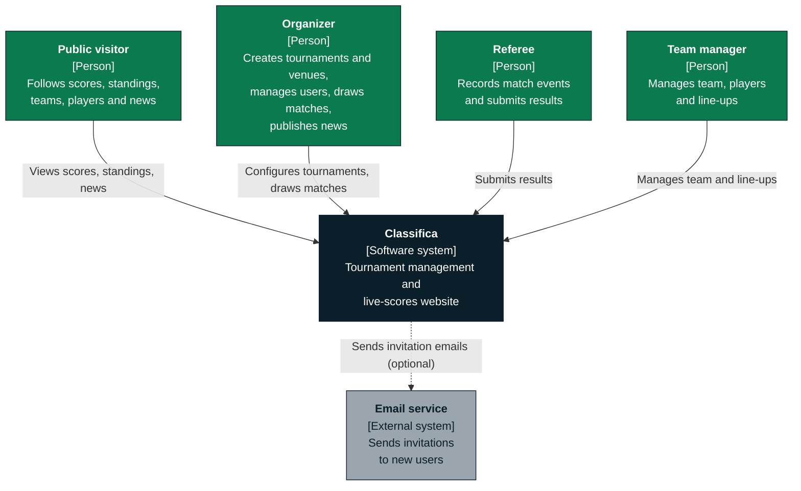
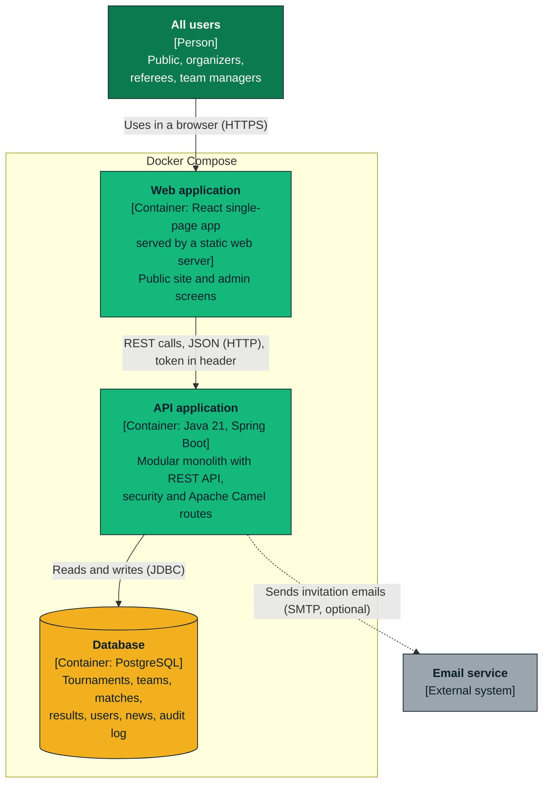

# C4 Diagrams

**Project:** Classifica
**Status:** Draft v1 (level 1 and level 2; the component diagram comes after the domain model)

The diagrams are written in Mermaid, so GitHub draws them directly from this file. Dashed arrows are optional or planned features.

## Level 1: System context

Who uses Classifica and which other systems it talks to.

| Element | Responsibility |
|---|---|
| Public visitor | Uses the site without logging in |
| Organizer | Main actor: owns tournaments and gives access to referees and team managers |
| Referee | Enters match events and results for assigned matches |
| Team manager | Maintains own team, players, and match line-ups |
| Email service | External service used to send invitations (extra feature) |

## Level 2: Containers

The deployable parts of Classifica and how they communicate. All three containers run together with Docker Compose.

| Container | Technology | Responsibility |
|---|---|---|
| Web application | React with Vite | Public site (scores, standings, news, search, favourites, language, theme) and admin screens for organizers, referees, and team managers |
| API application | Spring Boot, Gradle, Apache Camel | All business rules (draw, conflict checks, standings), authentication and authorization, REST API, integration routes |
| Database | PostgreSQL | Single source of truth for all data |

### Notes

- The web application never talks to the database. Every rule is enforced in the API, which is what keeps data consistent and secure (see the architecture characteristics).
- Favourites and the chosen theme and language are stored in the visitor's browser, so they do not appear in the database.
- The API is the only part that talks to external systems.
- Decision behind this structure: `docs/decisions/0001-architectural-style.md`.
