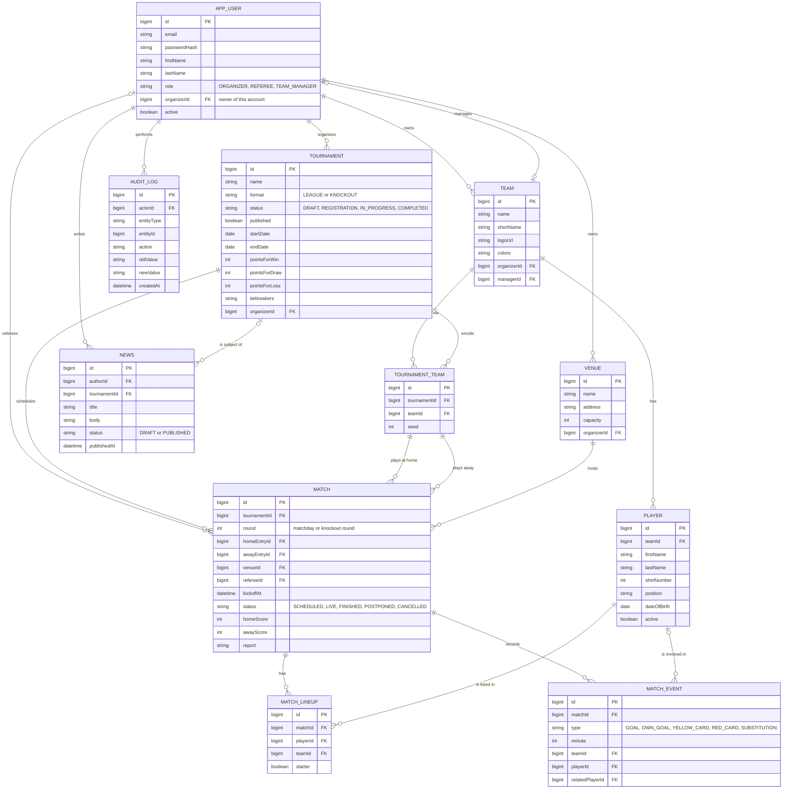

# Domain Model

**Project:** Classifica
**Status:** Draft v1

## 1. Key idea

A **team and its players exist independently of any tournament**. A team takes part in a tournament through an **entry** (`TournamentTeam`). This allows the same team to play in several tournaments over time, each with its own matches, results, and standings.

## 2. Entity-relationship diagram

The table is named `app_user` because `user` is a reserved word in PostgreSQL.

## 3. Entities

| Entity | Meaning |
|---|---|
| App user | Anyone who logs in: an organizer, or a referee or team manager created by an organizer. Referees and team managers belong to the organizer that created them |
| Venue | A place where matches are played, owned by an organizer |
| Team | A team with its colors and logo, owned by an organizer and run by one team manager |
| Player | A person in a team's squad |
| Tournament | A competition with a format, a status, and its scoring rules |
| Tournament team | One team's entry in one tournament (this is what makes teams reusable) |
| Match | One game in a tournament: teams, date and time, venue, referee, status, and score |
| Match line-up | The players a team submits for one match, and whether they start |
| Match event | A goal, card, or substitution at a given minute |
| News | An article by an organizer, optionally about one tournament |
| Audit log | A record of who changed what, and when |

## 4. Derived data (not stored)

- **League standings** are calculated from finished matches using the tournament's points and tiebreaker settings. This keeps standings always consistent with the results.
- **Knockout bracket** is derived from the matches' rounds and their winners.
- **Player statistics** (goals, cards) are calculated from match events.

## 5. Business rules

1. A tournament's format cannot change once it is in progress.
2. A team can be entered in a tournament only once.
3. **Conflict checks** when scheduling a match: the same venue, the same referee, or the same team cannot be in two matches whose times overlap. A default match duration is used for the overlap check.
4. A line-up may only contain players of that team.
5. Only the assigned referee can submit events and the result of a match. An organizer can correct them, and every correction creates an audit log entry.
6. A finished match must have a score; a cancelled or postponed match has none.
7. The public site only shows tournaments that are published and not in draft.
8. Every organizer sees and changes only their own data. Referees and team managers see only what belongs to them.
9. A knockout match cannot end in a draw: the winner is decided by the tournament's draw rule (extra time and penalties).
10. A team can be entered in only one unfinished tournament at a time. It can join another tournament once its current one is COMPLETED.

## 6. Assumptions and open points

- A team belongs to one organizer and can only be entered into that organizer's tournaments. Sharing teams between organizers is out of scope.
- A player belongs to one team at a time. Past matches keep their history through line-ups and events.
- The default match duration is configurable, with 2 hours as the starting value.
